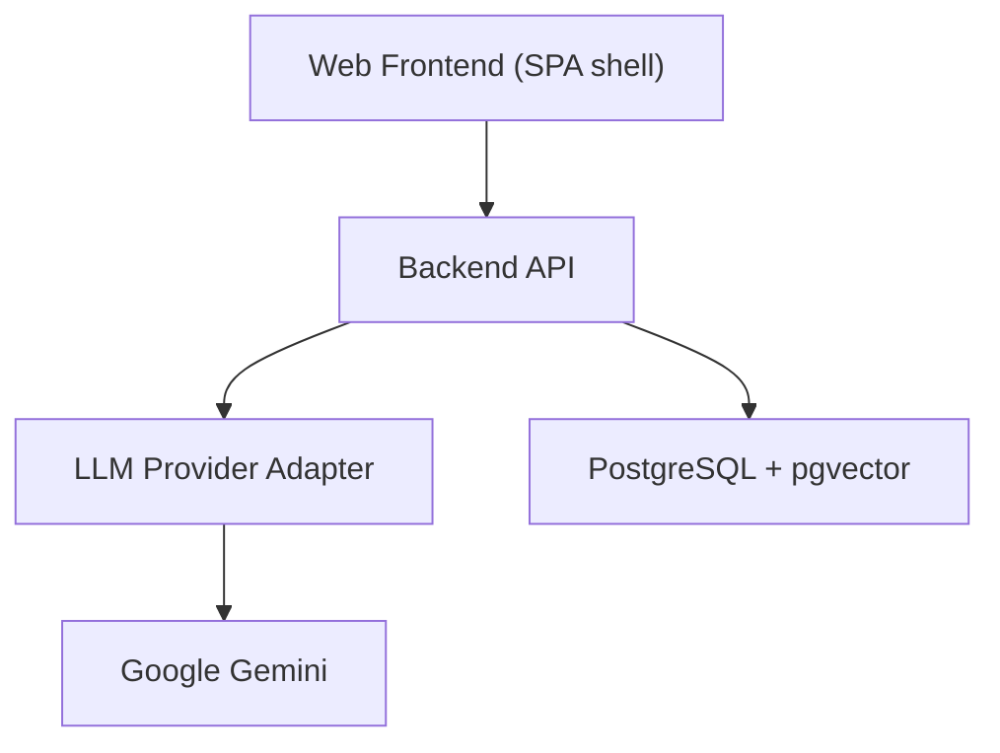
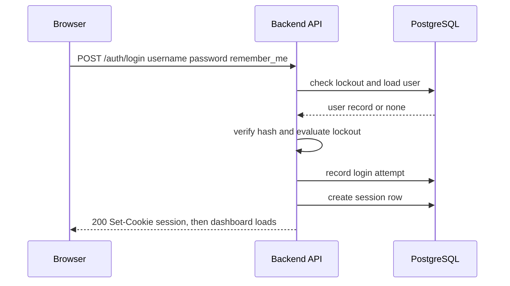
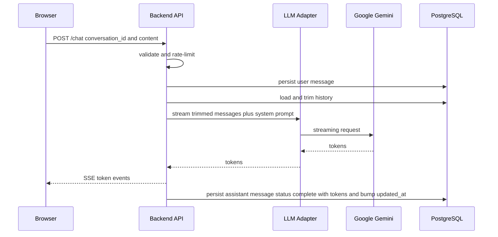
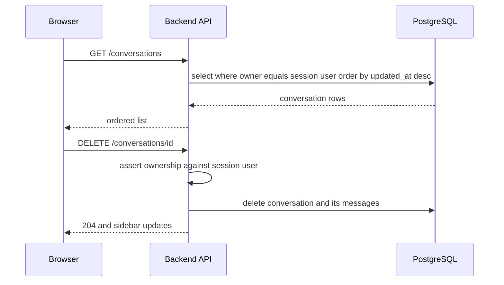
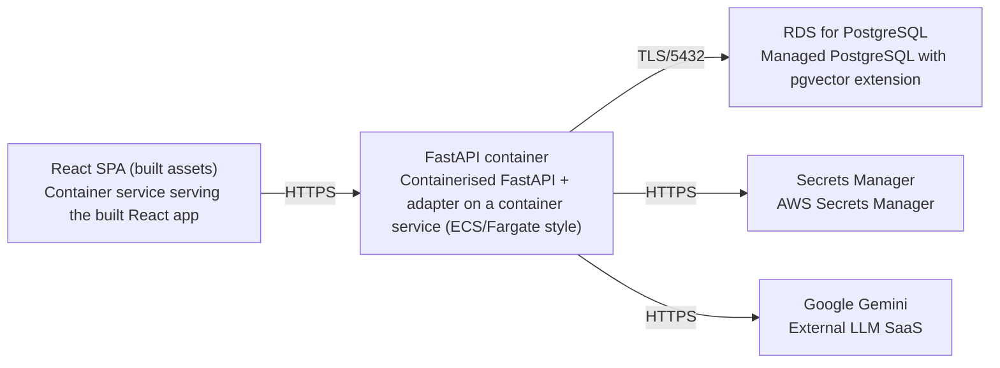

# Architecture

> Maintained by QuorQ AI SDLC. Text between `sdlc:auto` markers is regenerated; anything outside them is yours and is kept.

<!-- sdlc:auto:start narrative -->
## Overview

### ARCH-001 · approved · source: architecture:summary

Approved v1 architecture: React 19 SPA shell plus FastAPI 0.115 backend owning the mandated chat flow, PostgreSQL 16 + pgvector as single system of record, Gemini behind one backend adapter, containerised on AWS.

Components:
- frontend: Web Frontend (SPA shell, React 19) -- renders standalone login pre-auth / full dashboard post-auth; chat pane with streaming, Markdown, composer, conversation sidebar, theme, settings; redirects logged-out visitors to /login.
- backend_api: Backend API (FastAPI 0.115) -- auth, session, conversation, message, chat-streaming and health endpoints; enforces ownership, CSRF, CORS, rate limiting, lockout, persist-before-final flow; seeds admin on startup.
- llm_adapter: LLM Provider Adapter (FastAPI 0.115) -- single backend adapter with generate()/stream(), routes to Gemini with timeout/retry, key server-side, providers swappable by config.
- database: PostgreSQL + pgvector (PostgreSQL 16) -- system of record for users, sessions, conversations, messages, settings, login attempts, audit logs; hosts pgvector embedding columns for future KB work.
- gemini: Google Gemini -- external managed LLM, called only by the backend adapter.
Document upload/RAG, self-registration, native apps and media-in-chat are explicitly out of scope.

**Related:** EPIC-001, EPIC-002, EPIC-003, EPIC-004, EPIC-005

### ARCH-002 · approved · source: architecture:critical_paths

Critical path: sign-in, session and lockout.

Authenticate username/password with identical generic errors; create a server-side session row with HttpOnly/Secure/SameSite cookie (8h default, 30d with Remember me); record every attempt; lock a username after five failures in 15 minutes.

**Related:** US-002, US-003, US-006

### ARCH-003 · approved · source: architecture:critical_paths

Critical path: send message with streamed reply.

Mandated chat flow: validate input, persist the user message, load and trim history to the context window, prepend the system prompt, call the Gemini adapter, stream tokens as SSE, then persist the assistant message with status/model/token counts and bump conversation updated_at.

**Related:** US-014, US-015, US-019, US-020

### ARCH-004 · approved · source: architecture:critical_paths

Critical path: conversation ownership and persistence.

List, open, rename and delete conversations, always validating ownership against the session user on the server and loading history from PostgreSQL so browser state is never the source of truth.

**Related:** US-022, US-024, US-025, US-026, US-027, US-028

### ARCH-005 · approved · source: architecture:entities

Data model: seven tables covering identity, chat and audit data.

- users: id, username, password_hash, role, must_change_password, is_active, created_at, updated_at
- sessions: id, user_id, token_hash, remember_me, expires_at, created_at
- conversations: id, user_id, title, created_at, updated_at
- messages: id, conversation_id, role, content, status, model, prompt_tokens, completion_tokens, embedding, created_at
- settings: id, user_id, theme, created_at, updated_at
- login_attempts: id, username, outcome, ip_address, created_at
- audit_logs: id, user_id, action, detail, created_at

**Related:** EPIC-001, EPIC-003, EPIC-004, EPIC-005

### ARCH-006 · approved · source: architecture:endpoints

Backend API surface: auth, session, conversation, message, chat-streaming and health endpoints.

- POST /auth/login -- authenticate, enforce lockout, create session, set cookie.
- POST /auth/logout -- invalidate session, clear cookie.
- GET /auth/me -- return signed-in user's username and role.
- POST /auth/change-password -- change own password (current+new+confirm); also used for forced first-login change.
- GET /conversations -- list signed-in user's conversations, updated_at descending.
- POST /conversations -- create a new conversation for the signed-in user.
- GET /conversations/{id} -- load conversation + messages, ownership enforced.
- PATCH /conversations/{id} -- rename; rejects empty/whitespace titles.
- DELETE /conversations/{id} -- delete conversation + messages after owner validation.
- POST /chat -- mandated chat flow; streams SSE; auto-titles new conversation from first message.
- GET /health -- reports DB and provider reachability without exposing secrets.

**Related:** US-002, US-005, US-009, US-014, US-022, US-024, US-025, US-026, US-032

### ARCH-007 · approved · source: architecture:deployment_nodes

Deployment topology: containerised SPA + API on AWS against managed PostgreSQL, with Secrets Manager and external Gemini.

- React SPA (built assets) -- container service serving built React app, Node build, static served via container.
- FastAPI container -- containerised FastAPI + adapter on a container service (ECS/Fargate style), Python 3.12 / uvicorn.
- RDS for PostgreSQL -- managed PostgreSQL with pgvector extension, PostgreSQL 16.
- Secrets Manager -- AWS Secrets Manager, AWS managed.
- Google Gemini -- external LLM SaaS, managed API.

**Related:** US-029, EPIC-005

### ARCH-008 · approved · source: architecture:technology_decisions

Technology decisions and rationale, with alternatives considered.

- Frontend: React 19 (alternatives: Vue, Svelte) -- a single app shell validates session then renders either the centred login card or full dashboard, satisfying the strict two-state rule; handles SSE rendering, Markdown, Stop and theme client-side.
- Backend: FastAPI 0.115 (alternatives: Django, Flask) -- async model keeps long-lived SSE connections cheap and maps cleanly onto the mandated validate/persist/trim/prepend/call/stream/persist flow; Gemini/OpenAI/Anthropic Python SDKs make the swap-by-configuration adapter realistic.
- Database: PostgreSQL 16 (alternatives: MySQL, MongoDB) -- single system of record for users/sessions/conversations/messages/settings/login attempts/audit logs so ownership checks and lockout run against the same store; pgvector ships embedding columns at no cost until Knowledge Base is enabled; SQLite banned everywhere.
- Cloud: AWS (alternatives: GCP, Azure) -- RDS for PostgreSQL gives pgvector via one extension command plus managed backups/point-in-time restore for the only copy of every conversation; a container service runs FastAPI + built React; Secrets Manager keeps GEMINI_API_KEY and SESSION_SECRET backend-only.

**Related:** REQ-STACK
<!-- sdlc:auto:end narrative -->

<!-- sdlc:auto:start building-blocks -->
## Building Block View

| ID | Name | Technology | Responsibility | Depends on |
|---|---|---|---|---|
| frontend | Web Frontend (SPA shell) | React 19 | Renders the standalone login page before auth and the authenticated dashboard after; chat pane with token streaming, Markdown rendering, composer, conversation sidebar, theme and settings; redirects logged-out visitors to /login. | backend_api |
| backend_api | Backend API | FastAPI 0.115 | FastAPI application exposing auth, session, conversation, message, chat-streaming and health endpoints; enforces ownership, CSRF, CORS, rate limiting, lockout and the mandated persist-before-final chat flow; seeds the admin account on startup. | database, llm_adapter |
| llm_adapter | LLM Provider Adapter | FastAPI 0.115 | Single backend adapter exposing generate(messages, settings) and stream(messages, settings); routes model calls to Google Gemini with timeout and limited retry/backoff, keeping the key server-side and providers swappable by configuration. | gemini |
| database | PostgreSQL + pgvector | PostgreSQL 16 | Persistent system of record for users, sessions, conversations, messages, settings, login attempts and audit logs; hosts pgvector-typed embedding columns for future knowledge-base work. | — |
| gemini | Google Gemini | Google Gemini | External managed LLM supplying streamed chat completions; called only by the backend adapter. | — |

<!-- sdlc:auto:end building-blocks -->

<!-- sdlc:auto:start runtime -->
## Runtime View

### Sign-in, session and lockout

Authenticate username/password with identical generic errors, create a server-side session row with an HTTP-only Secure SameSite cookie (8h default, 30d with Remember me), record every attempt, and lock a username after five failures in 15 minutes.

- **Components:** frontend, backend_api, database
- **Modules:** auth.routes, auth.service, auth.sessions, auth.lockout, security.hashing
- **Key functions:** login(username, password, remember_me), verify_password(hash, plain), record_attempt(username, outcome), is_locked(username), create_session(user_id, remember_me), get_current_user(cookie)

### Send message with streamed reply

The mandated chat flow: validate input, persist the user message, load and trim history to the context window, prepend the system prompt, call the Gemini adapter, stream tokens as SSE, then persist the assistant message with status, model and token counts and bump the conversation updated_at.

- **Components:** frontend, backend_api, llm_adapter, database, gemini
- **Modules:** chat.routes, chat.flow, chat.history, llm.adapter, conversations.service, messages.repo, ratelimit
- **Key functions:** post_chat(conversation_id, content), check_rate_limit(user_id), persist_user_message(conversation_id, content), build_prompt(history, system_prompt, window), adapter.stream(messages, settings), persist_assistant_message(status, tokens)

### Conversation ownership and persistence

List, open, rename and delete conversations, always validating ownership against the session user on the server and loading history from PostgreSQL so browser state is never the source of truth.

- **Components:** frontend, backend_api, database
- **Modules:** conversations.routes, conversations.service, ownership.guard, messages.repo
- **Key functions:** list_conversations(user_id), get_conversation(user_id, id), rename_conversation(user_id, id, title), delete_conversation(user_id, id), assert_owner(user_id, conversation)

<!-- sdlc:auto:end runtime -->

<!-- sdlc:auto:start deployment-view -->
## Deployment View

| Name | Service | Runtime | Scaling | Environment |
|---|---|---|---|---|
| React SPA (built assets) | Container service serving the built React app | Node build, static served via container | 1 task (dev) | dev |
| FastAPI container | Containerised FastAPI + adapter on a container service (ECS/Fargate style) | Python 3.12 / uvicorn | 1 task, horizontally scalable (dev) | dev |
| RDS for PostgreSQL | Managed PostgreSQL with pgvector extension | PostgreSQL 16 | single managed instance with automated backups and PITR (dev) | dev |
| Secrets Manager | AWS Secrets Manager | AWS managed | n/a | dev |
| Google Gemini | External LLM SaaS | Managed API | n/a | dev |

| Source | Target | Protocol |
|---|---|---|
| React SPA (built assets) | FastAPI container | HTTPS |
| FastAPI container | RDS for PostgreSQL | TLS/5432 |
| FastAPI container | Secrets Manager | HTTPS |
| FastAPI container | Google Gemini | HTTPS |

<!-- sdlc:auto:end deployment-view -->

<!-- sdlc:auto:start decisions -->
## Architecture Decisions

| Layer | Choice | ADR |
|---|---|---|
| Frontend | React 19 | [ADR-0001](adr/frontend.md) |
| Backend | FastAPI 0.115 | [ADR-0002](adr/backend.md) |
| Database | PostgreSQL 16 | [ADR-0003](adr/database.md) |
| Cloud | AWS | [ADR-0004](adr/cloud.md) |
<!-- sdlc:auto:end decisions -->

<!-- sdlc:auto:start links -->
## Related Documents

- [Data Model](data-model.md)
- [API Specification](api/openapi.yaml)
- [Architecture Decision Records](adr/README.md)
<!-- sdlc:auto:end links -->
