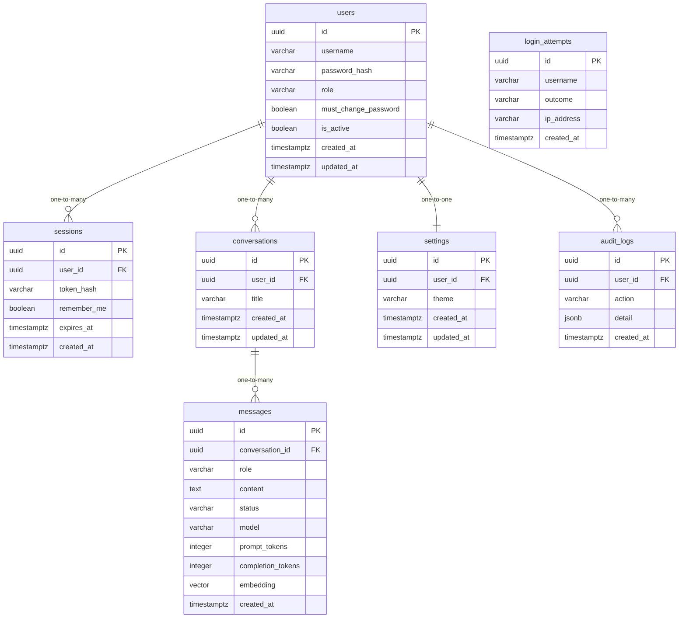

# Data Model

<!-- sdlc:auto:start entities -->
### users

| Field | Type | PK | FK | Nullable |
|---|---|---|---|---|
| id | uuid | True | — | False |
| username | varchar | False | — | False |
| password_hash | varchar | False | — | False |
| role | varchar | False | — | False |
| must_change_password | boolean | False | — | False |
| is_active | boolean | False | — | False |
| created_at | timestamptz | False | — | False |
| updated_at | timestamptz | False | — | False |

### sessions

| Field | Type | PK | FK | Nullable |
|---|---|---|---|---|
| id | uuid | True | — | False |
| user_id | uuid | False | users.id | False |
| token_hash | varchar | False | — | False |
| remember_me | boolean | False | — | False |
| expires_at | timestamptz | False | — | False |
| created_at | timestamptz | False | — | False |

### conversations

| Field | Type | PK | FK | Nullable |
|---|---|---|---|---|
| id | uuid | True | — | False |
| user_id | uuid | False | users.id | False |
| title | varchar | False | — | False |
| created_at | timestamptz | False | — | False |
| updated_at | timestamptz | False | — | False |

### messages

| Field | Type | PK | FK | Nullable |
|---|---|---|---|---|
| id | uuid | True | — | False |
| conversation_id | uuid | False | conversations.id | False |
| role | varchar | False | — | False |
| content | text | False | — | False |
| status | varchar | False | — | False |
| model | varchar | False | — | True |
| prompt_tokens | integer | False | — | True |
| completion_tokens | integer | False | — | True |
| embedding | vector | False | — | True |
| created_at | timestamptz | False | — | False |

### settings

| Field | Type | PK | FK | Nullable |
|---|---|---|---|---|
| id | uuid | True | — | False |
| user_id | uuid | False | users.id | False |
| theme | varchar | False | — | False |
| created_at | timestamptz | False | — | False |
| updated_at | timestamptz | False | — | False |

### login_attempts

| Field | Type | PK | FK | Nullable |
|---|---|---|---|---|
| id | uuid | True | — | False |
| username | varchar | False | — | False |
| outcome | varchar | False | — | False |
| ip_address | varchar | False | — | True |
| created_at | timestamptz | False | — | False |

### audit_logs

| Field | Type | PK | FK | Nullable |
|---|---|---|---|---|
| id | uuid | True | — | False |
| user_id | uuid | False | users.id | True |
| action | varchar | False | — | False |
| detail | jsonb | False | — | True |
| created_at | timestamptz | False | — | False |
<!-- sdlc:auto:end entities -->

<!-- sdlc:auto:start relationships -->
| Source | Target | Type |
|---|---|---|
| users | sessions | one-to-many |
| users | conversations | one-to-many |
| conversations | messages | one-to-many |
| users | settings | one-to-one |
| users | audit_logs | one-to-many |
<!-- sdlc:auto:end relationships -->

<!-- sdlc:auto:start er-diagram -->

<!-- sdlc:auto:end er-diagram -->
