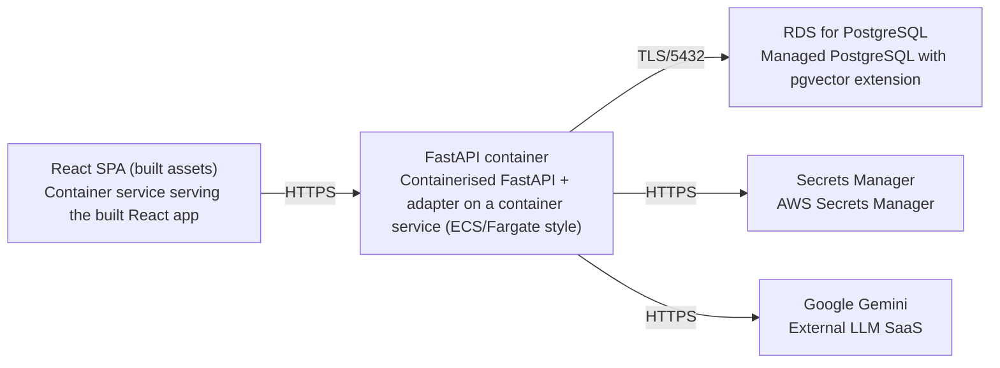

# Deployment Guide

> Maintained by QuorQ AI SDLC. Text between `sdlc:auto` markers is regenerated; anything outside them is yours and is kept.

<!-- sdlc:auto:start how-it-deploys -->
Pushes to `main` run `.github/workflows/deploy.yml`, which builds the API image (if there is a backend) and deploys the SPA to AWS Amplify. Commits touching only `docs/sdlc/**` don't deploy. Deployments can also be started from the platform's Deployment tab.
<!-- sdlc:auto:end how-it-deploys -->

<!-- sdlc:auto:start environments -->
| Name | Service | Runtime | Scaling | Environment |
|---|---|---|---|---|
| React SPA (built assets) | Container service serving the built React app | Node build, static served via container | 1 task (dev) | dev |
| FastAPI container | Containerised FastAPI + adapter on a container service (ECS/Fargate style) | Python 3.12 / uvicorn | 1 task, horizontally scalable (dev) | dev |
| RDS for PostgreSQL | Managed PostgreSQL with pgvector extension | PostgreSQL 16 | single managed instance with automated backups and PITR (dev) | dev |
| Secrets Manager | AWS Secrets Manager | AWS managed | n/a | dev |
| Google Gemini | External LLM SaaS | Managed API | n/a | dev |
<!-- sdlc:auto:end environments -->

<!-- sdlc:auto:start live -->
_Not deployed yet._
<!-- sdlc:auto:end live -->

<!-- sdlc:auto:start topology -->

<!-- sdlc:auto:end topology -->
